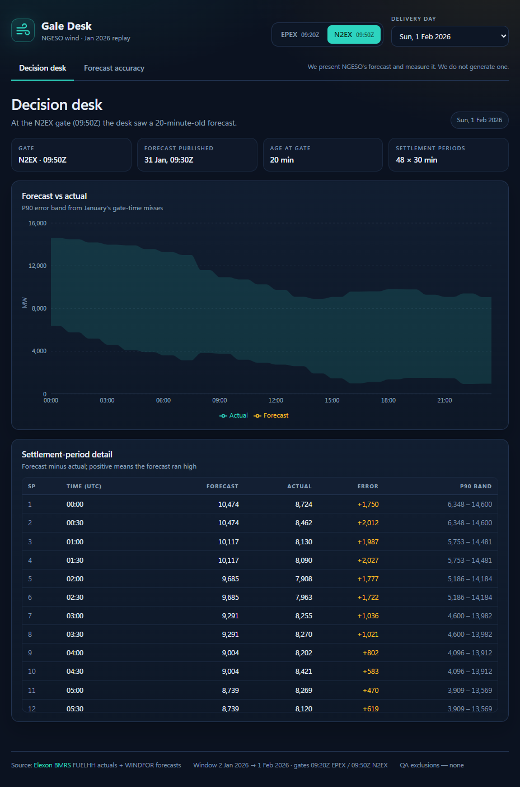
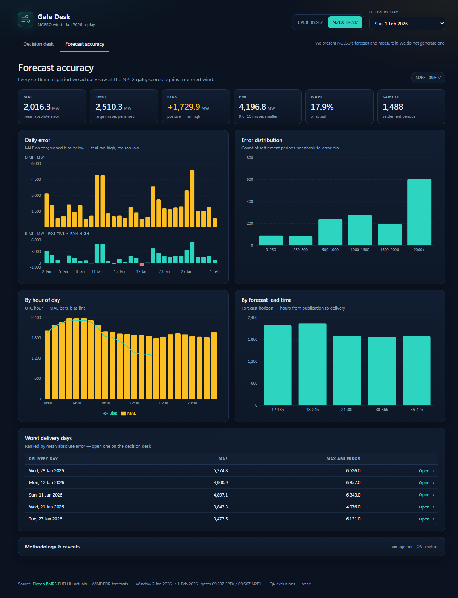

# Gale Desk

A day-ahead wind forecast desk for a UK electricity supplier. January 2026 replay.

Gale Desk does **not** predict wind and does **not** calculate procurement. NGESO publishes the wind forecast; this app shows the forecast that was genuinely available when the desk had to buy, then quantifies how wrong those forecasts were.

**Live demo:** _pending Vercel deployment._





## What it does

### 1. Decision desk

For a delivery day `D`, the desk buys at a day-ahead auction on `D-1`. The app finds the newest WINDFOR run published at or before that gate:

| Gate | Cutoff | Run used | Age at gate |
|---|---|---|---|
| EPEX GB DA | 09:20Z | 07:30Z | 1 h 50 m |
| N2EX GB DA | 09:50Z | 09:30Z | 20 min |

The Decision desk shows all 48 settlement periods for the chosen delivery day: forecast, actual, error, and an in-sample P90 error band. The band is requirement 2 feeding requirement 1: the buyer sees both the number and how much to distrust it.

### 2. Forecast accuracy

The Accuracy tab scores every settlement period in the window. It shows MAE, RMSE, bias, P90 absolute error and WAPE, plus:

- daily MAE and signed bias
- error distribution
- error by hour of day
- error by forecast horizon
- the five worst delivery days, clickable through to the Decision desk

The daily and hourly cards use two stacked panels: MAE bars on top, signed bias bars below around a zero line (teal = forecast ran high, red = ran low).

### Results

| Metric | N2EX (09:50Z) | EPEX (09:20Z) |
|---|---|---|
| MAE | 2,016 MW | 2,042 MW |
| RMSE | 2,510 MW | 2,509 MW |
| Bias | +1,730 MW | +1,748 MW |
| P90 absolute error | 4,197 MW | 4,140 MW |
| WAPE | 17.9% | 18.1% |
| Settlement periods | 1,488 | 1,488 |

Worst delivery day: **28 Jan 2026**, MAE 5,375 MW.

## Data

The brief scopes **purchase decisions made in January 2026**, so the app is scoped by decision date:

- decision gates: **1–31 Jan 2026**
- delivery days: **2 Jan – 1 Feb 2026** (31 days, 1,488 half-hours)
- forecasts fetched by `publishTime`; actuals by `settlementDate`

Sources (Elexon BMRS, public, no API key, no pagination):

- `FUELHH` actual generation, `fuelType=WIND`, 30-minute resolution
- `WINDFOR` wind generation forecasts, hourly, 8 runs per day

`ingest.py` fetches both in ≤7-day chunks (10 requests) and writes `backend/data/artifact.json`:

- 1,488 actual rows (31 days × 48 settlement periods)
- 18,104 forecast rows (248 runs × 73 hours)
- 1.84 MB, committed so the app runs with no network access

To rebuild it:

```
cd backend
python ingest.py
```

## Method

**Vintage selection.** For delivery day `D` and gate `G`, take the latest `publishTime <= (D-1 at G)`. Never borrow a later run. A vintage older than 24 hours is rejected.

**Step-hold.** WINDFOR is hourly and FUELHH is half-hourly. Each hourly forecast is held across both settlement periods. The join is on `(publishTime, startTime)`, never `startTime` alone — otherwise the eight overlapping vintages duplicate every hour.

**QA.** Zero or missing actuals are excluded and counted. Missing forecast hours are excluded and counted. Both counts are exposed in `/api/meta` and the UI footer.

**Metrics.** `error = forecast - actual`.

- MAE: mean absolute error
- RMSE: large misses penalised
- Bias: mean signed error; positive means the forecast ran high
- P90: 90th percentile of absolute error
- WAPE: `Σ|error| / Σactual`

MAPE is deliberately rejected: it is undefined at zero and unstable at low wind.

**Error band.** The P90 band is the 90th percentile of absolute error for each delivery hour, computed over the whole window. It is in-sample: it describes January's observed misses, not a guarantee.

## Design decisions

- **Scope by decision date, not delivery date.** The forecast available depends on when the decision is made, so gates run 1–31 Jan and deliveries run 2 Jan–1 Feb. This is the literal reading of the brief.
- **Two gates, one analysis.** EPEX and N2EX have different cutoffs, so they see different forecast runs. Showing both makes the cost of gate timing visible instead of asserting a preference.
- **Settlement period is the unit of analysis.** That is the unit the desk buys. WINDFOR's hourly forecast is step-held, not treated as 48 independent forecasts.
- **Replay, not live.** January 2026 is fixed and complete, so the demo is deterministic and requires no API keys or live feed at runtime.

## Project structure

```
app/
  backend/
    ingest.py            # Elexon FUELHH + WINDFOR -> data/artifact.json
    analytics.py         # vintage selection, step-hold, QA, metrics
    app.py               # FastAPI: /api/meta, /api/days, /api/day, /api/summary
    test_analytics.py    # 7 tests: selection, look-ahead, join, QA, metrics
    test_app.py          # 5 tests: contract, error paths, real numbers
    requirements.txt
    data/artifact.json   # committed January 2026 dataset
  frontend/
    src/App.jsx          # shell, gate toggle, date picker, tabs
    src/DecisionDesk.jsx # 48-SP chart + P90 band + table
    src/Accuracy.jsx     # KPIs, stacked daily/hourly panels, worst days
    src/api.js
    src/format.js
    src/styles.css
  docs/                  # README screenshots
  Dockerfile             # multi-stage: node build -> python:3.12-slim
  .dockerignore
```

## Run locally

Backend (Python 3.12):

```
cd backend
python -m venv .venv
.venv\Scripts\activate        # Windows
# source .venv/bin/activate   # macOS/Linux
pip install -r requirements.txt
uvicorn app:app --reload --port 8000
```

Frontend (Node 24, or 20+):

```
cd frontend
npm install
npm run dev
```

Open <http://localhost:5173>. Vite proxies `/api` to `http://localhost:8000`.

API docs: <http://localhost:8000/docs>.

## Run with Docker

```
cd app
docker build -t gale-desk .
docker run --rm -p 8000:8000 gale-desk
```

Open <http://localhost:8000>. One container serves the React build and the API from the same origin.

## Tests

```
cd backend
pytest -q          # 12 passed

cd ../frontend
npm test           # 1 passed
```

Backend tests cover vintage selection, no look-ahead over 31 days × 2 gates, step-hold, QA exclusion, toy metric values, the full 48-SP join, and the API contract. Frontend tests cover the formatting helpers.

## API

| Endpoint | Returns |
|---|---|
| `GET /api/meta` | window, gates, counts, exclusions, caveats |
| `GET /api/days` | delivery dates |
| `GET /api/day/{date}?gate=` | 48 settlement periods with forecast, actual, error, band |
| `GET /api/summary?gate=` | KPIs, daily series, histogram, by hour, by horizon, worst days |

## Deployment

Heroku has no free tier (Eco dyno is paid), so the deployment target is **Vercel**:

- React static build
- FastAPI as a Vercel Python service
- the `Dockerfile` remains the reproducible single-container build for any Docker host

_Live URL: pending._

## Scope and non-goals

- No demand, price or other-fuel data. The app cannot calculate how much power the utility must procure, and does not claim to.
- No forecast model. NGESO produces the forecast; the app presents and evaluates it.
- No live feed. This is a fixed January 2026 replay.

## Caveats

- `FUELHH` WIND is **transmission-metered** outturn, not total GB wind. `WINDFOR` is NGESO's national wind forecast. The mean forecast is 15.3% above the metered actuals (correlation 0.931), so part of the +1.73 GW bias may be a scope difference rather than forecast skill.
- The P90 band is **in-sample**.
- Hour-of-day and forecast horizon are collinear in this window; do not read the two charts as independent effects.
- MAPE is omitted on purpose; WAPE is the robust percentage metric.

## AI tools

Built with AI coding agents in two coordinated sessions — one for the Python backend and analysis, one for the React frontend and Docker — with human review of both. Model: DeepSeek V4.1 via OpenCode. Domain research, Elexon API verification, data-quality checks and test execution were AI-assisted. Every number in this README comes from the committed pipeline; no metric is hand-entered.
